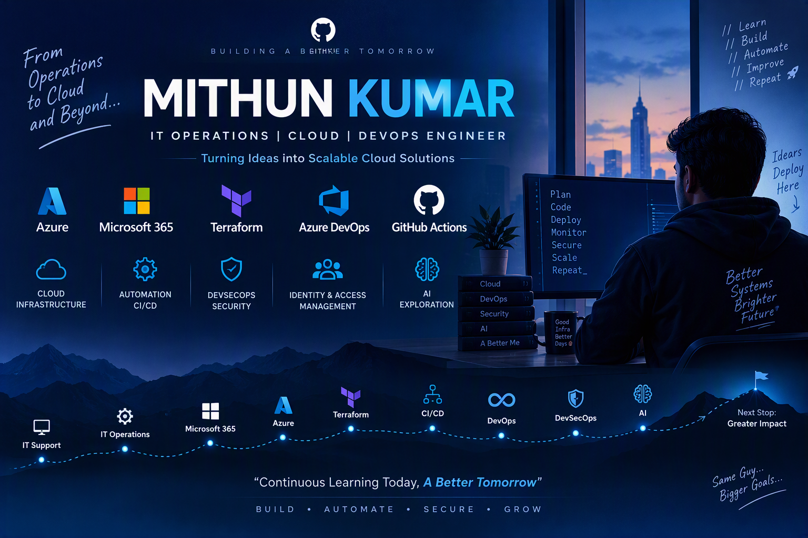

<p align="center">
  
</p>

<div align="center">

# Hi, I'm Mithun Kumar

### ☁️ Azure Cloud | ⚙️ DevOps | 🏗️ Terraform | 🔐 Microsoft 365 | 🚀 CI/CD


</div>

---

## 👨‍💻 About Me

I'm an **IT Operations & Cloud professional** building my career toward **Azure Cloud and DevOps Engineering**.

My journey started with hands-on hardware, desktop, and infrastructure support and gradually evolved into **Microsoft 365, Azure, Identity Management, Infrastructure as Code, CI/CD, automation, and DevOps**.

I enjoy learning technologies by building things, breaking things, troubleshooting them, and understanding how they actually work behind the scenes.


- 💼 Working in **IT Operations and Cloud Support**
- ☁️ Building hands-on expertise in **Microsoft Azure**
- 🏗️ Provisioning Azure infrastructure using **Terraform**
- ⚙️ Working with **Azure DevOps YAML Pipelines**
- 🚀 Exploring **GitHub Actions** for CI/CD automation
- 🔐 Working with **Microsoft Entra ID, IAM & RBAC concepts**
- 🖥️ Experience with **Microsoft 365, Intune & Exchange Online**
- 🐧 Strengthening my **Linux administration** skills
- 🔒 Learning **DevSecOps** and Infrastructure Security
- 🤖 Exploring **Generative AI, RAG & AI Agents**
- 📚 Continuously learning through real-world labs and projects
- 🎯 Build secure, automated, scalable cloud infrastructure


> **IT Support → IT Operations → Microsoft 365 → Microsoft Azure → Terraform → CI/CD/DevOps → DevSecOps → Cloud Automation**


---
# 🛠️ Tech Stack

## 🏗️ Infrastructure as Code

<p>
  
  
  
  
</p>

I use **Terraform** to build repeatable, modular, and automated infrastructure on Microsoft Azure.

### Terraform skills

- Providers, resources, variables, and outputs
- Local values and data sources
- Maps, objects, and nested configurations
- `for_each` and dynamic resource creation
- Reusable Terraform modules
- AzureRM provider
- Azure Storage remote backend
- State locking and remote state management
- Service Principal and OIDC authentication

---


## ☁️ Cloud & Microsoft Ecosystem

<p>
  
  
  
  
  
</p>

### Azure areas I work with / practice

- Azure Virtual Machines
- Virtual Networks & Subnets
- Network Security Groups
- Network Interfaces
- Azure Bastion
- Azure Load Balancer
- Azure Storage Accounts
- Resource Groups
- Azure RBAC
- Service Principals
- Identity & Access Management
- Terraform Remote State

---

# 🏢 Azure Tenant, Management Groups & Governance

A strong Azure platform starts with a well-structured identity, governance and subscription model.

### 🔹 Tenant & Management Group Hierarchy

```text
Microsoft Entra ID
        │
        ▼
Root Management Group
        │
        ├── Platform
        │     ├── Management
        │     ├── Connectivity
        │     └── Identity
        │
        └── Landing Zones
              ├── Production
              ├── Non-Production
              └── Sandbox
```

### Key Areas

- Microsoft Entra ID
- Root Management Group configuration
- Management Group hierarchy
- Tenant & Subscription boundaries
- Platform and Application Subscription design
- Azure Policy & Initiatives
- Azure RBAC
- Subscription onboarding & offboarding
- Policy exemptions with proper justification
- Tenant hierarchy best practices

---

# 🔐 Enterprise Governance & Identity

<p>
  
  
  
  
</p>

### Focus Areas

- User & Group Management
- Azure RBAC
- Role delegation
- Azure Policy
- Policy initiatives
- Microsoft Defender
- Centralized inspection
- Shared connectivity
- Controlled egress

### Azure Cloud Adoption Framework Journey

```text
Strategy
   ↓
Plan
   ↓
Ready
   ↓
Adopt
   ↓
Govern
   ↓
Secure
   ↓
Manage
```

---

# 🌐 Azure Networking | Hub & Spoke

<p>
  
  
  
  
</p>

### Architecture

```text
                    ┌───────────────┐
                    │      HUB      │
                    │               │
                    │ Firewall      │
                    │ VPN / ER      │
                    │ Shared DNS    │
                    └───────┬───────┘
                            │
                  VNet Peering
              ┌─────────────┼─────────────┐
              │             │             │
              ▼             ▼             ▼
           Spoke 01      Spoke 02      Spoke 03
             App           Data          Shared
```

### Networking Areas

- Hub-and-Spoke network architecture
- IP Address Management
- CIDR planning
- Enterprise CIDR segmentation
- Hub-to-Spoke VNet Peering
- User Defined Routes (UDRs)
- Azure Firewall rules
- Private DNS Zones
- Private Endpoints
- VPN Gateway
- ExpressRoute

---

# 🛡️ Security

My cloud security learning follows a layered approach:

```text
┌───────────────────────────┐
│     Identity Security     │
├───────────────────────────┤
│      Network Security     │
├───────────────────────────┤
│    Governance Security    │
├───────────────────────────┤
│      Compute Security     │
└───────────────────────────┘
```

### Focus

- Identity & Access Management
- Role-Based Access Control
- Least Privilege Access
- Network segmentation
- Azure Firewall
- NSGs
- Private connectivity
- Azure Policy
- Infrastructure security
- Secure CI/CD authentication

---

# 🏗️ Terraform & Landing Zone Automation

<p>
  
  
  
  
</p>

I use **Terraform** to build repeatable, modular and automated Azure infrastructure.

### Core Terraform Areas

- Terraform Providers & Resources
- Input Variables & Outputs
- Local Values
- Data Sources
- Maps & Objects
- `for_each`
- Reusable Terraform Modules
- AzureRM Provider
- Remote State
- Azure Storage Backend
- State file encryption
- Least-privilege access
- Terraform linting
- Security scanning
- Infrastructure testing
- Manual approvals
- Pipeline-based drift detection

### Example

```hcl
resource "azurerm_resource_group" "main" {
  name     = "rg-mithun-devops"
  location = "Central India"
}
```

### Terraform Deployment Flow

```text
Terraform Code
      ↓
terraform fmt
      ↓
terraform validate
      ↓
TFLint
      ↓
Security Scan
      ↓
Terraform Plan
      ↓
Manual Approval
      ↓
Terraform Apply
      ↓
Microsoft Azure
```

---

# ⚙️ Azure Repos & Azure DevOps Pipelines

<p>
  
  
  
  
  
</p>

### Source Control & Branch Governance

- Git branching strategies
- Feature branches
- Trunk-based development concepts
- Branch policies
- Protected branches
- Pull Request workflows
- Mandatory PR validation
- Required reviewers
- Code ownership
- Branch protection & controlled deletion

### Azure DevOps Pipeline

```text
Developer
    ↓
Feature Branch
    ↓
Pull Request
    ↓
Branch Policy
    ↓
Terraform Validate
    ↓
Security Scan
    ↓
Terraform Plan
    ↓
Review / Approval
    ↓
Terraform Apply
    ↓
Azure
```

### Pipeline Areas

- Azure DevOps YAML Pipelines
- Build and deployment stages
- Terraform validation
- Terraform Plan & Apply
- Rollback considerations
- Parallel jobs
- Self-hosted agents
- Pipeline variables
- Secrets management
- Manual approvals
- Service Principal authentication
- OIDC / Federated Authentication
- Shell scripting

---

# 🔒 DevSecOps

<p>
  
  
  
  
</p>

> **Security should be integrated into the pipeline, not added after deployment.**

### DevSecOps Toolchain

- 🔍 **TFLint** – Terraform linting & quality checks
- 🛡️ **tfsec** – Infrastructure security scanning
- 🔑 **Gitleaks** – Secret detection
- 💰 **Infracost** – Infrastructure cost visibility
- 🔐 **Azure RBAC** – Role-based access control
- 🪪 **OIDC** – Passwordless workload authentication

---

# ☁️ Cloud Migration

I am developing knowledge around structured cloud migration planning and execution.

### Migration Lifecycle

```text
Discovery
    ↓
Assessment
    ↓
Readiness
    ↓
Pre-Checks
    ↓
Migration
    ↓
Cutover
    ↓
Post-Checks
    ↓
Hypercare
```

### Key Areas

- Migration Strategy
- Infrastructure discovery
- Assessment & readiness
- Pre-migration checks
- During-migration checks
- Cutover planning
- Post-migration checks
- Hypercare

---

# 💰 FinOps & Cost Optimization

<p>
  
  
</p>

Building awareness around cloud financial management and optimization.

### Focus Areas

- Cost Optimization
- Idle resource identification
- Unattached disk identification
- Oversized compute resources
- Under-utilized resources
- Low-utilization resources
- Unnecessary log ingestion
- Reserved Capacity utilization
- Backup retention optimization

---

# 💾 Backup, Disaster Recovery & High Availability

<p>
  
  
  
</p>

### Backup & Resiliency Concepts

```text
Backup & Storage
├── LRS
├── ZRS
└── GRS

Compute Availability
└── VM Scale Sets

Disaster Recovery
├── RTO
└── RPO

Regional Resiliency
├── Primary Region
└── Secondary Region
```

### Focus

- Backup planning
- Locally Redundant Storage (LRS)
- Zone-Redundant Storage (ZRS)
- Geo-Redundant Storage (GRS)
- VM Scale Sets
- Recovery Time Objective (RTO)
- Recovery Point Objective (RPO)
- Primary / Secondary Region concepts
- High Availability
- Disaster Recovery planning

---

# 📊 Monitoring & Observability

<p>
  
  
</p>

Monitoring is an important part of operating reliable cloud environments.

### Current Focus

- Azure Monitor
- Infrastructure monitoring
- Operational visibility
- Cloud resource health awareness

---

# 🤖 AI for Cloud & DevOps

<p>
  
  
  
</p>

I'm exploring how AI can complement modern Cloud & DevOps workflows.

### Learning Areas

- Generative AI
- Large Language Models
- Retrieval-Augmented Generation (RAG)
- AI Agents
- AI-powered automation
- Infrastructure troubleshooting
- Knowledge retrieval
- Technical documentation

---

# 🚀 Featured Projects

## 1️⃣ Enterprise Azure Landing Zone with Terraform

Building modular Azure infrastructure covering:

```text
Management Groups
      ↓
Subscriptions
      ↓
Azure Policies & RBAC
      ↓
Hub & Spoke Network
      ↓
Shared Services
      ↓
Landing Zones
      ↓
Application Workloads
```

**Technologies:** `Azure` `Terraform` `AzureRM` `Entra ID` `RBAC` `Azure Policy`

---

## 2️⃣ Terraform CI/CD with Azure DevOps

Automating infrastructure deployment through:

```text
Azure Repos
     ↓
Pull Request
     ↓
Branch Validation
     ↓
Terraform Validate
     ↓
TFLint / Security Scan
     ↓
Terraform Plan
     ↓
Approval
     ↓
Terraform Apply
     ↓
Microsoft Azure
```

**Technologies:** `Azure DevOps` `Terraform` `YAML` `TFLint` `tfsec`

---

## 3️⃣ GitHub Actions + Azure OIDC

Exploring passwordless cloud deployment using:

```text
GitHub Actions
      ↓
OIDC Token
      ↓
Microsoft Entra ID
      ↓
Federated Identity
      ↓
Azure RBAC
      ↓
Azure Resources
```

**Technologies:** `GitHub Actions` `OIDC` `Microsoft Entra ID` `Azure` `Terraform`

---

# 📚 Currently Learning

```yaml

Operations:
  - Cloud Migration
  - FinOps
  - Backup & Disaster Recovery
  - High Availability
  - Azure Monitor

AI:
  - Generative AI
  - RAG
  - AI Agents
```

---

# 🎯 Professional Focus

My goal is to continue developing as an **Azure Cloud & DevOps Engineer**, bringing together my IT Operations experience with modern cloud engineering practices.

```text
                 Microsoft Azure
                       │
             ┌─────────┼─────────┐
             ▼         ▼         ▼
         Governance  Security  Networking
             │         │         │
             └─────────┼─────────┘
                       ▼
                    Terraform
                       │
                       ▼
                     CI/CD
                       │
                       ▼
                    DevOps
                       │
              ┌────────┼────────┐
              ▼        ▼        ▼
          DevSecOps  FinOps   Monitoring
                       │
                       ▼
                  Automation
```

---


# 🤝 Let's Connect

I enjoy connecting with professionals and communities interested in:

**Azure • Terraform • DevOps • CI/CD • Cloud Infrastructure • Microsoft 365 • Cloud Security • Automation**

<p>
  <a href="YOUR_LINKEDIN_URL">
    
  </a>

  <a href="https://github.com/YOUR_GITHUB_USERNAME">
    
  </a>

  <a href="mailto:YOUR_EMAIL">
    
  </a>
</p>

---

<div align="center">

### ☁️ Build Infrastructure • ⚙️ Automate Deployments • 🔐 Secure by Design

**Learn • Build • Automate • Secure • Optimize • Improve 🚀**

</div>
